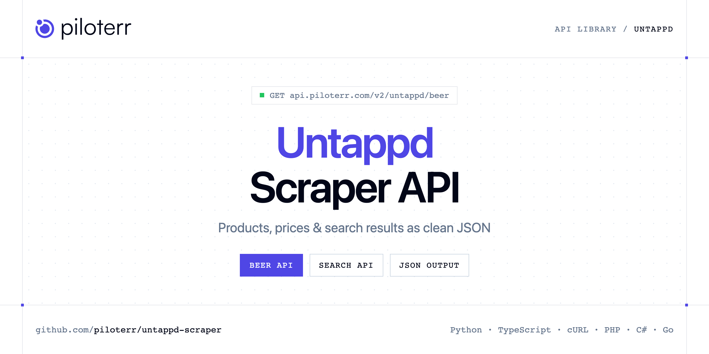

<p align="center">
  <a href="https://www.piloterr.com"></a>
</p>

# Untappd Scraper API

[](https://discord.gg/CFj3ph8aHU) [](https://app.piloterr.com) [](https://app.piloterr.com/openapi) [](LICENSE)

The **Piloterr Untappd Scraper API** lets you extract public data from Untappd as **clean, structured JSON** — no proxies, headless browsers or HTML parsing to maintain. Endpoints available in production:

- **Untappd Beer API** — Read one Untappd beer, including ABV, IBU, and brewery.
- **Untappd Search API** — Search Untappd beers by keyword.

Use it for price monitoring, assortment tracking, competitor analysis, product research or catalog enrichment.

| Endpoint | Path | Credits | What you get |
|---|---|---|---|
| [Untappd Beer API](#untappd-beer-api) | `/v2/untappd/beer` | 2 | Read one Untappd beer, including ABV, IBU, and brewery. |
| [Untappd Search API](#untappd-search-api) | `/v2/untappd/search` | 2 | Search Untappd beers by keyword. Cards include brewery, ABV, and IBU. next is null when Untappd does not expose a next page. |

## Table of contents

- [How it works](#how-it-works)
- [Untappd Beer API](#untappd-beer-api)
- [Untappd Search API](#untappd-search-api)
- [Code examples in other languages](#code-examples-in-other-languages)
- [Practical use cases](#practical-use-cases)
- [Why Piloterr?](#why-piloterr)
- [FAQ](#faq)
- [Related scrapers](#related-scrapers)
- [Support](#support)

## How it works

1. **Create a free Piloterr account** and copy your API key from the [dashboard](https://app.piloterr.com).
2. **Send a `GET` (or `POST`) request** to `https://api.piloterr.com/v2/...` with the header `x-api-key: YOUR_API_KEY`.
3. **Receive structured JSON** — Piloterr handles rendering, proxies, retries and parsing.

```bash
export PILOTERR_API_KEY="your-api-key"
pip install requests        # Python
# TypeScript: Node.js 18+ (native fetch), run with `npx tsx file.ts`
```

> Every endpoint accepts both `GET` (query string) and `POST` (JSON body with the same fields).

## Untappd Beer API

Read one Untappd beer, including ABV, IBU, and brewery.

`GET | POST https://api.piloterr.com/v2/untappd/beer` · **2 credits per request** · [Full reference](https://app.piloterr.com/openapi)

### Request parameters

| Parameter | Type | Required | Description |
|---|---|---|---|
| `query` | string | ✅ | Required. The numeric Untappd beer id from search, or a beer URL under /b/ or /beer/. A keyword is not accepted. |

### Python example

```python
import json
import os
import requests

response = requests.get(
    "https://api.piloterr.com/v2/untappd/beer",
    headers={"x-api-key": os.environ["PILOTERR_API_KEY"]},
    params={
        "query": "4509",
    },
    timeout=60,
)
response.raise_for_status()
data = response.json()

print(json.dumps(data, indent=2, ensure_ascii=False)[:2000])
```

### TypeScript example

```typescript
type UntappdBeer = {
  id?: string;
  abv?: number;
  ibu?: number;
  url?: string;
  name?: string;
  image?: string;
  style?: string;
  rating?: number;
  brewery?: string;
  abv_display?: string;
  brewery_url?: string;
  description?: string;
  ibu_display?: string;
  ratings_count?: number;
  total_checkins?: number;
  unique_checkins?: number;
  monthly_checkins?: number;
  total_checkins_display?: string;
};

const params = new URLSearchParams({
  "query": "4509",
});

const response = await fetch(`https://api.piloterr.com/v2/untappd/beer?${params}`, {
  headers: { "x-api-key": process.env.PILOTERR_API_KEY! },
});
if (!response.ok) throw new Error(`Piloterr error ${response.status}: ${await response.text()}`);

const data = (await response.json()) as UntappdBeer;

console.log(JSON.stringify(data, null, 2).slice(0, 2000));
```

<details>
<summary><b>POST variant</b></summary>

```http
POST https://api.piloterr.com/v2/untappd/beer
x-api-key: YOUR_API_KEY
Content-Type: application/json

{"query": "4509"}
```
</details>

### Output example

Example response from the API reference, abridged — real values depend on the page you scrape.

```json
{
  "id": "4509",
  "abv": 6.2,
  "ibu": 51,
  "url": "https://untappd.com/beer/4509",
  "name": "IPA",
  "image": "https://assets.untappd.com/site/beer_logos/beer-4509_21190_sm.jpeg",
  "style": "IPA - American",
  "rating": 3.6845,
  "brewery": "Lagunitas Brewing Company",
  "abv_display": "6.2% ABV",
  "brewery_url": "https://untappd.com/LagunitasBrewingCo",
  "description": "A well-rounded, Highly drinkable India Pale Ale. A bit of Caramel Malt barley provides the richness that mellows out the twang of the hop…",
  "ibu_display": "51 IBU",
  "ratings_count": 813594,
  "total_checkins": 1970000,
  "unique_checkins": 893270,
  "monthly_checkins": 3193,
  "total_checkins_display": "1.97M+"
}
```

### Response fields

| Field | Type | Description |
|---|---|---|
| `id` | string |  |
| `abv` | number |  |
| `ibu` | integer |  |
| `url` | string |  |
| `name` | string |  |
| `image` | string |  |
| `style` | string |  |
| `rating` | number |  |
| `brewery` | string |  |
| `abv_display` | string |  |
| `brewery_url` | string |  |
| `description` | string |  |
| `ibu_display` | string |  |
| `ratings_count` | integer |  |
| `total_checkins` | integer |  |
| `unique_checkins` | integer |  |
| `monthly_checkins` | integer |  |
| `total_checkins_display` | string |  |

## Untappd Search API

Search Untappd beers by keyword. Cards include brewery, ABV, and IBU. next is null when Untappd does not expose a next page.

`GET | POST https://api.piloterr.com/v2/untappd/search` · **2 credits per request** · [Full reference](https://app.piloterr.com/openapi)

### Request parameters

| Parameter | Type | Required | Description |
|---|---|---|---|
| `query` | string | ✅ | Required. A beer keyword, or an Untappd search URL whose path is /search. |

### Python example

```python
import json
import os
import requests

response = requests.get(
    "https://api.piloterr.com/v2/untappd/search",
    headers={"x-api-key": os.environ["PILOTERR_API_KEY"]},
    params={
        "query": "ipa",
    },
    timeout=60,
)
response.raise_for_status()
data = response.json()

print(json.dumps(data, indent=2, ensure_ascii=False)[:2000])
```

### TypeScript example

```typescript
type UntappdSearch = {
  results?: {
    id?: string;
    abv?: number;
    ibu?: number;
    url?: string;
    name?: string;
    image?: string;
    style?: string;
    rating?: number;
    brewery?: string;
    abv_display?: string;
    brewery_url?: string;
    ibu_display?: string;
  }[];
  pagination?: {
    next?: unknown;
    page?: number;
    per_page?: number;
    total_pages?: unknown;
    total_results?: number;
  };
};

const params = new URLSearchParams({
  "query": "ipa",
});

const response = await fetch(`https://api.piloterr.com/v2/untappd/search?${params}`, {
  headers: { "x-api-key": process.env.PILOTERR_API_KEY! },
});
if (!response.ok) throw new Error(`Piloterr error ${response.status}: ${await response.text()}`);

const data = (await response.json()) as UntappdSearch;

console.log(JSON.stringify(data, null, 2).slice(0, 2000));
```

<details>
<summary><b>POST variant</b></summary>

```http
POST https://api.piloterr.com/v2/untappd/search
x-api-key: YOUR_API_KEY
Content-Type: application/json

{"query": "ipa"}
```
</details>

### Output example

Example response from the API reference, abridged — real values depend on the page you scrape.

```json
{
  "results": [
    {
      "id": "4509",
      "abv": 6.2,
      "ibu": 51,
      "url": "https://untappd.com/b/lagunitas-brewing-company-ipa/4509",
      "name": "IPA",
      "image": "https://assets.untappd.com/site/beer_logos/beer-4509_21190_sm.jpeg",
      "style": "IPA - American",
      "rating": 3.68,
      "brewery": "Lagunitas Brewing Company",
      "abv_display": "6.2% ABV",
      "brewery_url": "https://untappd.com/brewery/765",
      "ibu_display": "51 IBU"
    }
  ],
  "pagination": {
    "next": null,
    "page": 1,
    "per_page": 5,
    "total_pages": null,
    "total_results": 401027
  }
}
```

### Response fields

| Field | Type | Description |
|---|---|---|
| `results[]` | object[] |  |
| `results[].id` | string |  |
| `results[].abv` | number |  |
| `results[].ibu` | integer |  |
| `results[].url` | string |  |
| `results[].name` | string |  |
| `results[].image` | string |  |
| `results[].style` | string |  |
| `results[].rating` | number |  |
| `results[].brewery` | string |  |
| `results[].abv_display` | string |  |
| `results[].brewery_url` | string |  |
| `results[].ibu_display` | string |  |
| `pagination` | object |  |
| `pagination.next` | object |  |
| `pagination.page` | integer |  |
| `pagination.per_page` | integer |  |
| `pagination.total_pages` | object |  |
| `pagination.total_results` | integer |  |

## Code examples in other languages

Ready-to-run examples live in the [`examples/`](examples) folder. Each one reads your key from the `PILOTERR_API_KEY` environment variable.

| Language | Beer | Search |
|---|---|---|
| cURL (Bash) | [`beer`](examples/curl/beer.sh) | [`search`](examples/curl/search.sh) |
| PHP | [`beer`](examples/php/beer.php) | [`search`](examples/php/search.php) |
| C# | [`beer`](examples/csharp/Beer.cs) | [`search`](examples/csharp/Search.cs) |
| Go | [`beer`](examples/go/beer.go) | [`search`](examples/go/search.go) |
| Java | [`beer`](examples/java/BeerExample.java) | [`search`](examples/java/SearchExample.java) |
| Ruby | [`beer`](examples/ruby/beer.rb) | [`search`](examples/ruby/search.rb) |
| Node.js | [`beer`](examples/nodejs/beer.mjs) | [`search`](examples/nodejs/search.mjs) |

## Practical use cases

- **Price monitoring** — Track prices, promotions and availability over time to react to competitors.
- **Assortment & catalog tracking** — Follow new products, delisted items and category changes.
- **Competitor analysis** — Benchmark ranges, brands and positioning across retailers.
- **Product research** — Spot best-sellers and trends from search results.
- **Catalog enrichment** — Pull titles, images and attributes into your PIM or marketplace listings.

## Why Piloterr?

- **No infrastructure** — no proxies, headless browsers or CAPTCHA solving to run yourself.
- **Structured JSON** — stable, documented fields instead of brittle HTML selectors.
- **Pay per request** — transparent credit cost per endpoint, failed requests are retried for you.
- **One API key, hundreds of sources** — Untappd plus many other e-commerce, search and company data endpoints in the [Piloterr library](https://www.piloterr.com/library).
- **Any language** — plain HTTPS + JSON, with examples for Python, TypeScript, cURL, PHP, C#, Go, Java, Ruby and Node.js.

## FAQ

### Is it legal to scrape Untappd?

Collecting publicly available data is generally allowed in many jurisdictions, but rules depend on your country, the data you collect and how you use it. Avoid personal data unless you have a lawful basis, respect the website's terms where they apply, and get legal advice for your specific use case. This is not legal advice.

### Do I need proxies or a headless browser?

No. Piloterr handles rendering, proxy rotation and retries on its side. You only send an HTTPS request with your `x-api-key` header and receive JSON.

### How much does a request cost?

Credits per call: `/v2/untappd/beer` **2**, `/v2/untappd/search` **2**. See the [Piloterr website](https://www.piloterr.com) for plans.

### What data does the Untappd API return?

Each endpoint returns structured JSON: **Untappd Beer** — `id`, `abv`, `ibu`, `url`, `name`, `image`; **Untappd Search** — `results[]`, `results[].id`, `results[].abv`, `results[].ibu`, `results[].url`, `results[].name`.

### Which languages are supported?

Any language that can make an HTTP request. This README shows Python and TypeScript; the [`examples/`](examples) folder contains cURL, PHP, C#, Go, Java, Ruby and Node.js.

## Related scrapers

- [About You Scraper API](https://github.com/piloterr/aboutyou-scraper)
- [Action Scraper API](https://github.com/piloterr/action-scraper)
- [Aldi Scraper API](https://github.com/piloterr/aldi-scraper)
- [Alibaba Scraper API](https://github.com/piloterr/alibaba-scraper)
- [AliExpress Scraper API](https://github.com/piloterr/aliexpress-scraper)
- [Allegro Scraper API](https://github.com/piloterr/allegro-scraper)
- [All Piloterr scrapers on GitHub](https://github.com/piloterr)

## Support

- 💬 Join the [Piloterr Discord](https://discord.gg/CFj3ph8aHU) to ask questions and share what you build.
- 📚 Browse the [API reference (OpenAPI)](https://app.piloterr.com/openapi) and the [Piloterr library](https://www.piloterr.com/library).
- 🔑 [Get your API key](https://app.piloterr.com).

---

<p align="center">
  <a href="https://www.piloterr.com">
    <picture>
      <source media="(prefers-color-scheme: dark)" srcset="images/logo-dark.svg">
      
    </picture>
  </a>
  <br>
  <sub>Built by <a href="https://www.piloterr.com">Piloterr</a> — web scraping APIs for e-commerce, search, real estate and more, one API key.</sub>
</p>

<sub>Untappd is a trademark of its respective owner. This repository is not affiliated with or endorsed by Untappd. Examples are released under the MIT license.</sub>
